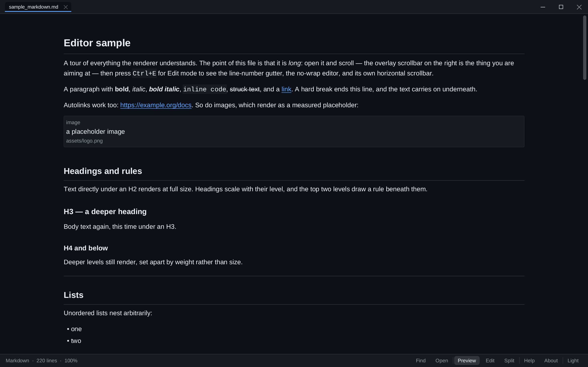
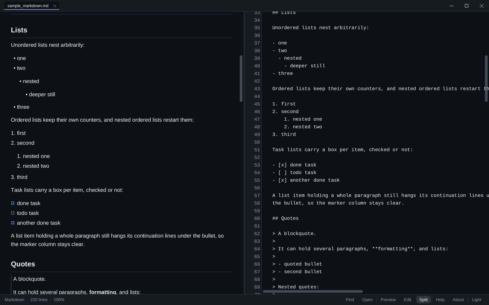
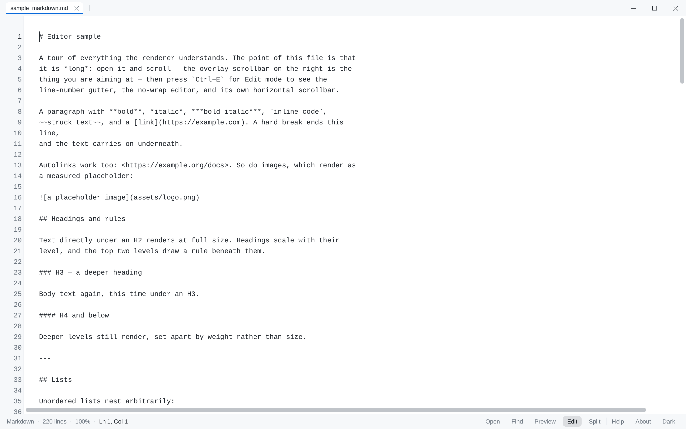
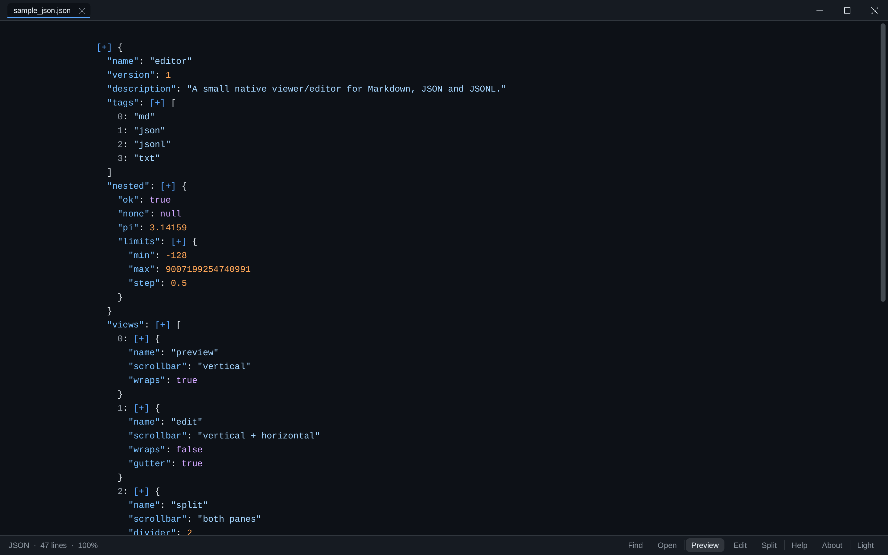
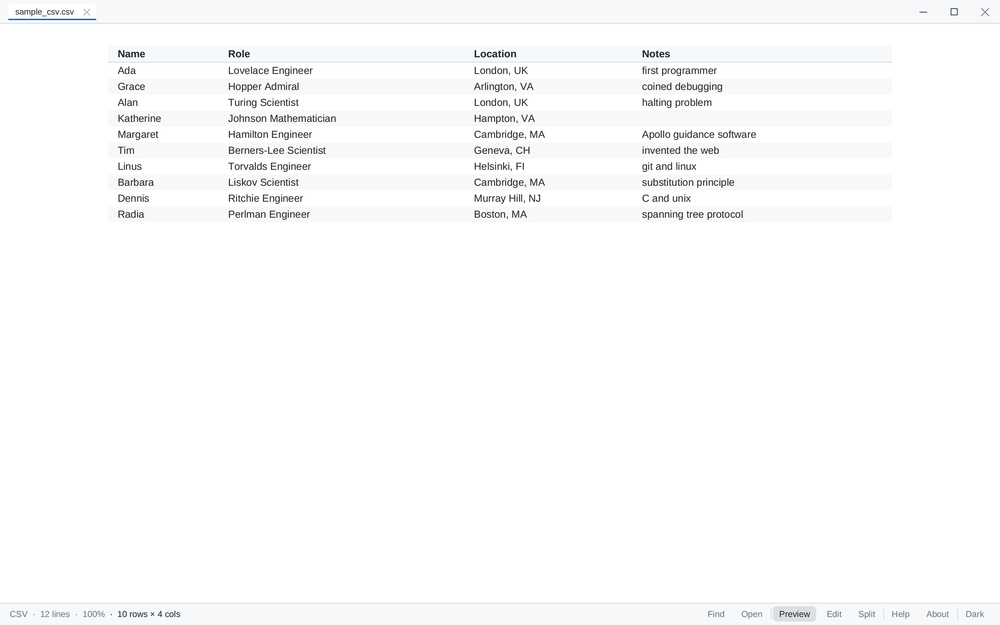
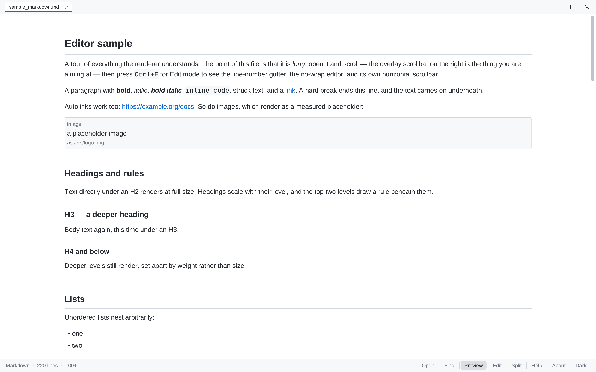
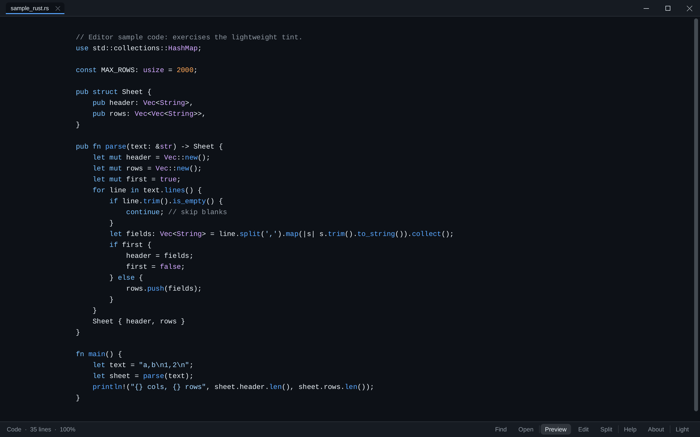
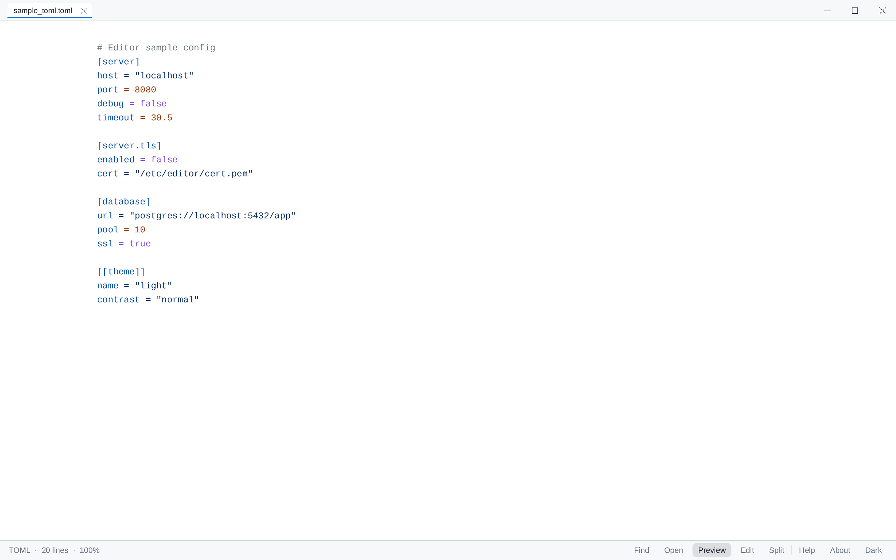
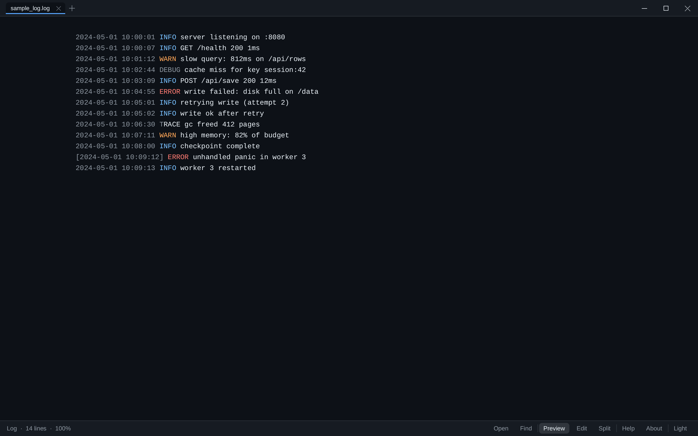

<p align="center">
  
</p>

<h1 align="center">Editor</h1>

<p align="center">
  <b>A small, native viewer and light editor for Markdown, JSON, CSV, configs, logs and code.</b><br>
  <sub>One Rust binary per OS. No frameworks, no runtime, no dependencies.</sub>
</p>

<p align="center">
  <a href="https://github.com/Eric-Lautanen/editor/releases/latest"></a>
  <a href="https://github.com/Eric-Lautanen/editor/actions/workflows/ci.yml"></a>
  
  
</p>

<p align="center">
  
</p>

Editor opens a file, renders it the way you want to read it, and gets out of
the way. Everything is drawn by its own software renderer onto a single
window: no web view, no toolkit, no runtime to install. `Ctrl+E` cycles
**Preview → Edit → Split**, so the same tab is both the document and the
source, and `Ctrl+F`, `F1` and `F2` cover the rest without leaving the
keyboard.

## Why this one

- **Preview first.** Documents open as clean rendered previews — headings and
  tables for Markdown, a collapsible tree for JSON, one tree per record for
  JSONL, a real column table for CSV/TSV — with the raw text one keystroke
  away. One renderer handles every kind of file, so a log, a TOML config and a
  Rust source all look like they belong to the same program.
- **Native, and it feels it.** A hand-drawn title bar with one tab per file,
  overlay scrollbars that stay out of the way, a line-number gutter, find, a
  right-click menu, drag and drop, touch panning, and crisp text at 150% and
  200% display scaling. Dark and light themes follow your OS until you pick
  one yourself with `Ctrl+T`.
- **Editing that stays out of the way.** Real selection, undo/redo, clipboard,
  save, and a Split view that re-renders the document as you type. Files that
  change on disk reload themselves; `Ctrl+R` forces it if you would rather.
- **Truly dependency-free.** `[dependencies]` in `Cargo.toml` is empty and
  stays that way: the Markdown, JSON and CSV parsers, the layout engine, a
  TrueType rasterizer with Unicode fallback, the software canvas, the SHA-256
  that verifies downloads, and the window and event layer for all three
  platforms (hand-bound Win32, AppKit and Xlib FFI) all live in this
  repository.
- **Installs cleanly, updates itself.** A per-user MSI with no admin prompt and
  no UAC; "Open with Editor" entries you can choose per file type; an optional
  Desktop shortcut. Updates are checked twice a day, verified against the
  release's SHA-256 manifest before anything runs, and the app comes back on
  the new version with your tabs where you left them. `--uninstall` removes
  everything it put down, including the installers it staged.
- **Never loses your place.** Open tabs, the file you were in, the view mode,
  the theme and the window's size and position all survive a restart —
  including a restart caused by an update.

## What's new (October 2026)

- **Markdown that matches GitHub.** The preview now renders the HTML a README
  actually uses: centred `<p>` and `<h1>` headers, `<div align="center">`,
  sized ``, `<details><summary>`, `<picture>` logos, and HTML
  tables — the side-by-side screenshot idiom, images and captions included.
  A line of badge images stays a line, and a badge opens the link it sits in.
  Inline HTML becomes real formatting (`<b>`,
  `<i>`, `<u>`, `<ins>`, `<mark>`, `<sup>`, `<sub>`, `<br>`, links, images),
  and GitHub alerts (`> [!NOTE]`, `[!TIP]`, `[!WARNING]`, …) become labelled
  callouts instead of anonymous quote bars. GitHub footnotes — `note[^1]`
  with a `[^1]: …` definition anywhere in the file — become raised numbers
  and a numbered list at the end, in the order the references appear rather
  than the order the definitions were written. A marker jumps to its note;
  the number or the ↩ at the end of a note goes back to the first reference.
  Comments and dangerous tags
  are dropped with their contents; an unknown tag keeps its text. Check your
  README before you push, not after.
- **The dotfiles open too.** `.gitignore`, `.gitattributes`, `.gitmodules`,
  `.editorconfig`, `.dockerignore`, `.npmrc`, `.nvmrc` and `.prettierrc` are
  real associations now on Windows and Linux, not plain text that happened to
  open. (macOS matches by extension, so a name like `.gitignore` is
  best-effort there.) The app also recognises bare names — `Dockerfile`,
  `Makefile`, `Rakefile`, `Gemfile`, `Procfile`, `Justfile`, `CODEOWNERS`,
  `LICENSE` — and Linux associates those by whole filename, which is the only
  platform with a mechanism for it.
- **An update that asks before it acts.** The Windows hand-off is a staged copy
  of the app, not a batch script, and it installs only when the window it
  belongs to left *for the update*: closing Editor yourself while a download
  runs, or typing into a dirty tab, cancels it instead of installing over you.
  Unsaved edits make the update refuse and say so. No installer can reboot the
  machine, and the window that comes back has your tabs, file and place.
- **Big files stay instant (0.2.5).** Jumping to the end of a multi-megabyte
  code file paints immediately: the highlighter carries its tint state along
  the document instead of re-deriving it from the top, a resize adopts that
  work instead of re-lexing, and `--pretty` prints without ever building the
  app at all. Measured by the repo's release-cost gate: the end-of-file
  keystroke went from a ~590 ms one-frame stall to band speed.
- **A sharper preview.** Markdown task lists get real check boxes, list items
  sit together instead of reading as one paragraph per bullet, tables band
  alternate rows, fenced code carries a language label, and an image
  placeholder names both its alt text and its source. JSON now reads as JSON —
  commas, `▼`/`▶` expanders, and exact alignment for wide keys — and CSV
  right-aligns numeric columns and bands its rows.
- **Code that knows its language.** The highlighter separates language
  families (Rust, Python, shell, Ruby, C-like/Go/PHP, JS/TS, SQL, Lua, JSON,
  HTML/XML, CSS, config) and understands their comment forms, strings, numbers, types
  and keywords — including block comments and Python docstrings that cross
  lines — with no new dependency.
- **Self-update you can trust.** Checks run twice a day, the download is
  verified against the release's `SHA256SUMS` before anything executes, and on
  Windows the fetch happens inside the app through the OS's own HTTP stack —
  never a script host — and no installer is left behind. An update
  closes the window and brings it back with your session intact.
- **An About box that answers quietly.** `F2 → Check for updates now` reports
  on a status line in the box. No dialog, and no system alert sound for a
  check that found nothing.
- **A cleaner install.** Per-user MSI with an optional Desktop shortcut; the
  uninstaller removes the staged update downloads along with the app.
- **Open a pile of files at once.** `editor a.md b.json c.log` opens three
  tabs, `--` ends the flags so a file called `-draft.md` opens fine, and one
  file is one tab however its path is spelled.
- **Text sits where it should.** Every centred row — status bar, menus, title
  bar, editor — is measured from real font metrics rather than an em box with
  the descender the wrong way round.

## Views

**Split** — the rendered document and its source on one screen, scrolled
from the same offset, each with its own scrollbar:



**Edit** — the raw file, no wrapping, with a line-number gutter and a
horizontal scrollbar for the lines that run long:



## What it renders

One renderer for every kind of file — each of these is a real file from
[`samples/`](samples), opened by the app and rendered headlessly:

<table>
  <tr>
    <td width="50%" align="center">
      <br>
      <sub><b>JSON</b> — a collapsible tree (<code>▶</code> / <code>▼</code>), commas and folded field counts, one per line for JSONL</sub>
    </td>
    <td width="50%" align="center">
      <br>
      <sub><b>CSV / TSV</b> — columns, a header band, right-aligned numbers, banded rows</sub>
    </td>
  </tr>
  <tr>
    <td width="50%" align="center">
      <br>
      <sub><b>Markdown</b> — headings, lists, quotes, tables, code, links</sub>
    </td>
    <td width="50%" align="center">
      <br>
      <sub><b>Code</b> — rs, py, js, ts, c, go, sh and friends, tinted</sub>
    </td>
  </tr>
  <tr>
    <td width="50%" align="center">
      <br>
      <sub><b>Configs</b> — YAML, TOML, INI/CFG/CONF</sub>
    </td>
    <td width="50%" align="center">
      <br>
      <sub><b>Logs</b> — levels tinted, plain text everything else</sub>
    </td>
  </tr>
</table>

Every screenshot above was drawn headlessly by the app itself
(`editor --render` on the files in [`samples/`](samples)) and converted to PNG
by [`tools/readme_shots.py`](tools/readme_shots.py) — there is no screenshot
tool in the loop, so the pictures cannot drift from what the renderer draws.

## Samples

[`samples/`](samples) is the tour: every file there is something the app
renders differently, and nothing there is filler.

| File | What it shows |
|---|---|
| [`sample_markdown.md`](samples/sample_markdown.md) | the whole Markdown tour: headings, rules, emphasis, code spans and fences, links, quotes, nested and task lists, a GFM table |
| [`sample_markdown_extra.md`](samples/sample_markdown_extra.md) | the edges of that tour — tables with alignment, awkward wrapping, unicode |
| [`sample_json.json`](samples/sample_json.json) | a collapsible tree with tinted keys, strings, numbers and booleans |
| [`sample_jsonl.jsonl`](samples/sample_jsonl.jsonl) | one tree per record, plus a deliberately broken line and the error banner it gets |
| [`sample_csv.csv`](samples/sample_csv.csv) / [`sample_tsv.tsv`](samples/sample_tsv.tsv) | measured columns, a header band, ragged rows |
| [`sample_yaml.yaml`](samples/sample_yaml.yaml) / [`sample_toml.toml`](samples/sample_toml.toml) / [`sample_ini.ini`](samples/sample_ini.ini) | config files, tinted by kind |
| [`sample_log.log`](samples/sample_log.log) | log levels tinted, everything else left alone |
| [`sample_rust.rs`](samples/sample_rust.rs) | source with a light syntax tint |
| [`sample_text.txt`](samples/sample_text.txt) | plain text in the reading column, long enough to scroll |

## Download

Grab the latest build from
[GitHub Releases](https://github.com/Eric-Lautanen/editor/releases/latest):

| File | For |
|---|---|
| `editor-<tag>-windows-x86_64.msi` | Windows 10/11 — the recommended install |
| `editor-<tag>-windows-x86_64.zip` | Windows — portable (no install) |
| `editor-<tag>-linux-x86_64.tar.gz` | Linux (X11/XWayland) |
| `editor-<tag>-macos.zip` | macOS |

Every release publishes a `SHA256SUMS` manifest listing the SHA-256 of each
asset; verify the file you download against it if you want to check it yourself.
The Windows build is Authenticode-signed and the macOS bundle is signed and
notarized when the release workflow has its signing secrets configured (see
[packaging/SIGNING.md](packaging/SIGNING.md)); without them the binaries are
unsigned and the OS will show its usual unknown-publisher warning.

## Install

### Windows

**Run the `.msi`** — that is the whole install. It is per-user, so there is no
admin prompt, and the wizard is one page with four checkboxes, all ticked:

| | |
|---|---|
| Documents and config files | md, markdown, json, jsonl, ndjson, txt, log, csv, tsv, yaml, yml, toml, ini, cfg, conf |
| Code and markup files | rs, py, js, ts, c, h, cpp, hpp, cs, java, go, rb, php, css, html, xml, sh |
| Dotfiles and tool config | gitignore, gitattributes, gitmodules, editorconfig, dockerignore, npmrc, nvmrc, prettierrc |
| Create a shortcut on the Desktop | a Start menu entry is always added |

These only *offer* Editor in the Explorer "Open with" menu — a file type you
have already assigned to another program keeps that program. The dotfile row
registers names like `.gitignore` the only way Windows can, as extension keys;
bare names such as `Dockerfile` and `LICENSE` have no per-filename association
on Windows, so they open through **Open with** rather than claiming a menu
entry. The install also adds an entry to Installed apps, and running the
installer again with different boxes ticked changes your choices.

The portable zip is the alternative: unzip it wherever you like and run
`editor --install` to register the same "Open with" entries (still per-user,
still no admin, and no shortcuts — the zip stays where you put it).
`editor --uninstall` removes them — and the staged update downloads in your
temp directory, so uninstalling does not leave a stray installer behind. Your
settings and recent-files list are kept (they are yours); delete
`%APPDATA%\Editor` to start completely fresh.

### Linux

Unpack the tarball and run `packaging/linux/install.sh`. It installs the
binary to `~/.local/bin`, adds a launcher to your applications menu **and a
shortcut on your Desktop**, installs the launcher icons, and makes Editor the
default app for Markdown, JSON, NDJSON, plain text, CSV, YAML and TOML, plus
the dotfiles and tool configs above and the bare names (`Dockerfile`,
`Makefile`, `Rakefile`, `Gemfile`, `Procfile`, `Justfile`, `CODEOWNERS`,
`LICENSE`). Linux is the one platform that can match a whole filename, so there
that list is exact. Set `EDITOR_NO_DESKTOP_SHORTCUT=1` to leave the Desktop
alone.

To undo all of it, delete `~/.local/bin/editor`,
`~/.local/share/applications/editor.desktop`, `~/Desktop/editor.desktop` and
`~/.local/share/icons/hicolor/*/apps/editor.png`.

### macOS

Unzip, then drag `Editor.app` into `/Applications`. The bundle declares the
same document types, including the dotfiles, so Finder's "Open With" offers it
for ordinary extensions; macOS matches by extension, so a bare name or a
`.gitignore` has no per-filename menu entry. There is no Desktop shortcut to
add here — the Dock and Spotlight are how an app is launched.

The bundle is not signed or notarized yet, so Gatekeeper refuses the first
launch of a downloaded copy: right-click the app and choose **Open** once
(or run `xattr -d com.apple.quarantine /Applications/Editor.app`).

### From source

```
cargo run -- samples/sample_markdown.md
cargo test
```

Release-mode binaries for your own OS come from `cargo build --release`.

## Updating

Editor checks GitHub for a newer release **at most twice a day**, while the
app is running. There is nothing to configure: the check is silent, and when
it finds a newer version it asks first — nothing is downloaded before you
click "Yes". Downloads are then verified against the release's checksum
manifest before the installer runs, so a truncated or tampered download is
refused, never executed.

You can turn the automatic check off in the app: **F2 (About) → uncheck
"Check for updates automatically"**, and check on demand with the **Check for
updates now** button right under it — that one runs off the clock and off the
setting, and answers on a status line in the box itself ("up to date", or the
version it can install). No dialog and no system sound for a check that found
nothing. Manual updates stay available:

```
editor --update      # check GitHub and install the newest release now
--no-update          # skip the automatic check for one launch
```

When an update installs, the app closes and comes back on the new version with
what you had open — the session file it wrote on the way out (open tabs, the
file you were in, the view, the window's size and place) is what the fresh
process reads. On Windows the hand-off is a staged copy of the app itself, not
a batch script: it waits for the old window to exit *and* for the approval that
window writes as it leaves, then runs the installer with `/passive
REBOOT=ReallySuppress MSIDISABLERMRESTART=1 MSIRESTARTMANAGERCONTROL=Disable
EDITOR_SKIP_LAUNCH=1`. An update can therefore close and reopen the app but
never reboot the machine, and the package itself launches nothing.

That approval is also what keeps an update from outliving the window that asked
for it. Close Editor yourself while the download runs, or type into a dirty tab
afterwards, and the hand-off is cancelled: nothing is installed, and the window
that is still there says why. Unsaved edits stop the install before the
download and again after the checksum. If the installer does refuse, the next
launch names its exit code in the About box instead of pretending it worked.
Linux and macOS have no helper to wait for them: the window saves, then starts
the newly installed build from the same tick. If that start fails, the old
window stays open rather than closing on nothing.

The whole attempt — check, download, checksum, the helper's wait, the
installer's exit code, the relaunch — is appended to `last-update.log` in the
app's config directory (`%APPDATA%\Editor` on Windows,
`$XDG_CONFIG_HOME/editor` or `~/.config/editor` on Linux, and
`~/Library/Application Support/Editor` on macOS), with the previous attempt
kept as `last-update.1.log`. So an update that misbehaves is diagnosable from
a file afterwards instead of by guesswork.

A newer install always replaces the older one in place, so file associations
keep working — re-running `--install` is only needed if you *move* the
executable. `editor --version` prints what you have.

The download itself is handed to your operating system rather than to a TLS
library compiled into the app. On Windows it happens **inside the app** —
`urlmon`, the OS's own HTTP stack — with the system `curl.exe` as the fallback;
nothing spawns a script host. `curl`, `wget` and `python3` elsewhere, tried in
order until one answers. A machine that blocks one of them (managed
corporate images, for instance) still updates through the next one, and a
machine that has none of them says so instead of failing silently. The
installer is staged under your temp directory and deleted by the next launch of
the installed version — and by an uninstall, along with everything else the
install put there.

## Using it

Every shortcut the app knows, generated from `src/ui/keymap.rs` — the F1
overlay paints the same table, and `cargo test` refuses a stale paste here or
a row whose chord no longer works:

<!-- keymap:start -->
| Keys | Action |
|---|---|
| `Ctrl+E` | cycle Preview → Edit → Split |
| `Ctrl+O` | open a file in a new tab |
| `drag & drop` | drop files onto the window to open them (Windows, macOS) |
| `Ctrl+Tab` | next tab (Shift = previous) |
| `Ctrl+R` | reload the active file from disk |
| `Ctrl+W` | close tab (press twice if unsaved) |
| `Ctrl+S` | save |
| `type` | edit the document |
| `arrows` | move the caret (Shift = select) |
| `mouse drag` | select text |
| `Ctrl+A` | select all |
| `Ctrl+C / X / V` | copy / cut / paste |
| `Ctrl+Z / Y` | undo / redo |
| `Tab` | insert four spaces |
| `wheel, arrows` | scroll |
| `double-click` | select a word in the preview; a third click takes the row |
| `Ctrl+F` | find bar (Enter/F3 next, Shift back) |
| `Ctrl + / - / 0` | zoom in / out / reset |
| `Ctrl+T` | light / dark theme |
| `click ▶` | fold / unfold JSON nodes |
| `hover a link` | show its address in the status bar; click to open it |
| `F1` | this help |
| `F2` | about editor |
| `right-click` | context menu |
| `Ctrl+Q` | quit |
<!-- keymap:end -->

A file also opens by double-clicking it or from right-click → Recent, and
`editor a.md b.md` opens several tabs at once. Tabs hold one file each, and a
second launch of Editor hands its files to the window already open (Windows
today), so "Open with Editor" lands as a tab rather than a second window. The
status bar carries the same mode, theme and zoom controls. Quit from `Ctrl+Q`
or the window's ×.

Your session — theme, view mode, open tabs, window size and position — is
restored on the next start.

## Console flags

The window is the whole product, but the binary answers a few console flags
for scripting and recovery (run `editor --help` for the authoritative list,
which `cli.rs` keeps next to its argument parser):

| Flag | What it does |
|---|---|
| `editor [FILE ...]` | open files as tabs, in order; the first one focused |
| `--version` / `-V` | print the version |
| `--install` / `--uninstall` | register / remove the "Open with" entries (portable use) |
| `--update` | check GitHub and install the newest release now |
| `--no-update` | skip the automatic check for this one launch |
| `--pretty FILE` | print FILE: `.json`/`.jsonl` canonicalized (a broken one fails with its position), any other file echoed unchanged |

Dev-only flags (`--render OUT.ppm --size WxH --scale S --dark/--light
--mode preview|edit|split --scroll PX`, and `--mem-report` in `mem-census`
builds) draw the screenshots for this README and measure allocations; they
are documented in `--help` and used by the tests, not by people. One
diagnostic reads an environment variable rather than a flag: start with
`EDITOR_TOUCH_TRACE=1` and every touch phase — contact, move, the velocity
estimate at lift, `PanEnd`, the coast it starts, and the frames that advance
it — is appended to `%TEMP%\editor_touch_trace.log` (cost-free when off); a
reported "no touch inertia" is diagnosed from that log.

## Code signing policy

Signed Windows builds use [SignPath.io](https://signpath.io), with a
certificate issued by the [SignPath Foundation](https://signpath.org):

> Free code signing provided by SignPath.io, certificate by SignPath Foundation.

Roles: committers, reviewers and approvers are the repository's owner,
[Eric Lautanen](https://github.com/Eric-Lautanen). Every release is built by
this repository's GitHub Actions workflow on GitHub-hosted runners and is
manually approved before it is signed.

Privacy: this program will not transfer any information to other networked
systems unless specifically requested by the user or the person installing or
operating it. The only network request it can make is the update check, which
asks GitHub for the latest release and can be turned off with `--no-update`
or `EDITOR_NO_UPDATE_CHECK=1`.

## License

MIT — see [LICENSE](LICENSE). The bundled Liberation Sans & Mono fonts are
SIL OFL 1.1.
